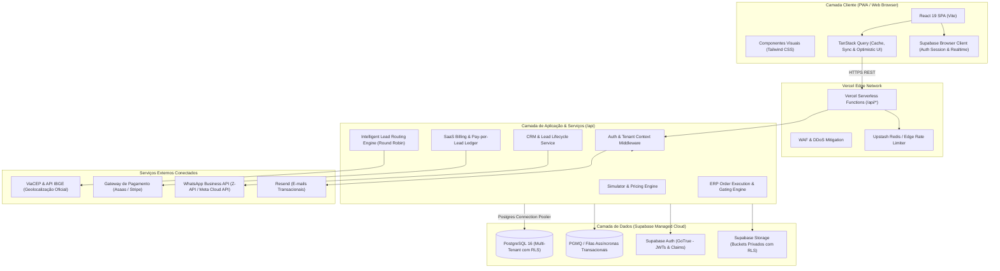
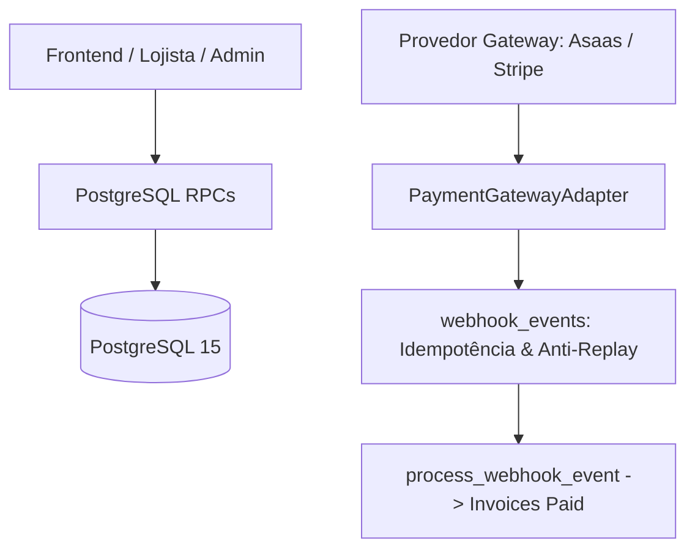

# ARQUITETURA DE SOFTWARE DO SAAS PLANEJAFÁCIL

**Versão:** 1.0.0  
**Perfil:** Modular Monolith Serverless (React 19 + TypeScript + Vercel + Supabase)  
**Padrão Arquitetural:** Clean Architecture / Hexagonal Ports & Adapters voltado a SaaS Multi-Tenant

---

## 1. VISÃO GERAL & DIRETRIZES FUNDAMENTAIS

O **PlanejaFácil** é uma plataforma SaaS B2B2C para o mercado de móveis planejados. O frontend existente em React 19, Vite e Tailwind CSS é preservado em sua totalidade visual e interativa. A arquitetura de produção substitui a camada de dados em memória (`AppContext` com mocks) por uma arquitetura serverless robusta, transacional e segura.

### Princípios Técnicos:
1. **Regras de Negócio no Backend:** Nenhuma regra de precificação, roteamento de lead ou transição de etapa do ERP é executada de forma definitiva no cliente. O frontend é responsável estritamente pela apresentação, coleta de inputs, validação preliminar de formulário e renderização reativa.
2. **Isolamento Estrito de Tenants (Multi-Tenancy):** Cada loja parceira opera como um tenant independente. A separação lógica é garantida em profundidade por **PostgreSQL Row Level Security (RLS)** e validada pela camada de aplicação.
3. **Idempotência Transacional:** Operações críticas (conversão de lead em pedido, faturamento por lead entregue, avanço de etapa do ERP) possuem identificadores únicos de idempotência, garantindo que retentativas de rede ou cliques duplos não gerem inconsistências ou duplicidades.
4. **Sem Microserviços Desnecessários:** Uma arquitetura modular unificada (Modular Monolith) hospedada na Vercel integrada ao Supabase Enterprise Managed oferece latência ultra-baixa, facilidade de manutenção e custo proporcional ao crescimento.

---

## 2. DIAGRAMA DA ARQUITETURA DE PRODUÇÃO



---

## 3. DIVISÃO DE CAMADAS (CLEAN ARCHITECTURE)

A estrutura do projeto adota a separação de responsabilidades em camadas:

```
src/
├── components/          # Camada de Apresentação (Pura UI, sem regras de negócio)
│   ├── admin/           # Telas do Administrador do SaaS
│   ├── common/          # Componentes visuais compartilhados (Logo, Modais)
│   ├── consumer/        # Landing Page, Simulador Wizard, Visualizador 3D
│   ├── layout/          # Navbar, Footer, MobileBottomNav
│   └── merchant/        # CRM, ERP Operacional, Analytics
├── context/             # Estados globais de interface do usuário (ex: tema, menu ativo)
├── hooks/               # Custom Hooks do React integrados ao TanStack Query
│   ├── useAuth.ts       # Hook de autenticação e sessão do usuário
│   ├── useLeads.ts      # Queries e mutations de leads com invalidação de cache
│   ├── useOrders.ts     # Gestão reativa de ordens de serviço do ERP
│   └── useSimulator.ts  # Estado da jornada do consumidor
├── lib/                 # Utilitários e instâncias de clientes
│   ├── api.ts           # Cliente HTTP configurado para Vercel Serverless Functions
│   ├── supabase.ts      # Cliente oficial Supabase (@supabase/supabase-js)
│   └── validations/     # Schemas de validação Zod (compartilhados entre client e server)
└── types/               # Tipos TypeScript de domínio e contratos de API

api/                     # Camada Serverless de Aplicação (Vercel Functions em TypeScript)
├── auth/                # Endpoints de autenticação complementar e convites
├── leads/               # Submissão de leads, roteamento e consulta
├── orders/              # Criação de pedidos, avanço de etapas e documentos
├── billing/             # Webhooks de pagamento e faturamento de leads
└── admin/               # Operações exclusivas do Super Administrador
```

---

## 4. CONTRATO DE API E ESTRATÉGIA DE SERVIÇOS

As regras de negócio são centralizadas em rotas protegidas em `/api/*`. Cada rota executa:
1. **Autenticação:** Extração e validação do token JWT emitido pelo Supabase Auth.
2. **Contexto de Tenant:** Identificação segura do `tenant_id` e papel (`role`) do usuário através do token e consulta à tabela `users`.
3. **Validação de Entrada:** Validação estrita do payload via **Zod Schemas**. Requisições inválidas são rejeitadas imediatamente (`400 Bad Request`).
4. **Execução Transacional:** Operações com múltiplos efeitos colaterais (ex: converter lead em pedido e gerar auditoria) executam dentro de transações atômicas no PostgreSQL (`BEGIN ... COMMIT`).
5. **Auditoria e Observabilidade:** Registro do log de auditoria com ID do operador, timestamp do servidor e IP.

---

## 5. ESTRATÉGIA DE GERENCIAMENTO DE ESTADO NO FRONTEND

O React Context atual (`AppContext.tsx`) será mantido durante a transição, mas terá sua implementação interna substituída:
- **TanStack Query (React Query v5):** Gerencia todo o estado assíncrono do servidor (leads, pedidos, métricas, lojas).
  - Cache inteligente em memória.
  - Revalidação em segundo plano (`stale-while-revalidate`).
  - Atualizações otimistas (Optimistic Updates) para transições do Kanban.
  - Eliminação de bugs de recarregamento (`F5`), garantindo persistência contínua.
- **Supabase Realtime (WebSockets):** O canal de leads do lojista assina atualizações do banco:
  ```typescript
  supabase
    .channel('merchant-leads')
    .on('postgres_changes', { event: 'INSERT', schema: 'public', table: 'lead_assignments', filter: `tenant_id=eq.${currentTenantId}` }, 
      (payload) => {
        // Notificação sonora / visual de novo lead recebido em tempo real
      }
    )
    .subscribe();
  ```

---

## 6. ESTRATÉGIA DE PROCESSAMENTO ASSÍNCRONO & FILAS

Operações com serviços externos ou que demandam alta confiabilidade utilizam filas transacionais no PostgreSQL via **PGMQ (Postgres Message Queue)**:
- **Disparo de Mensagens WhatsApp:** O lojista clica para contatar o cliente ou o sistema envia alerta automático; a mensagem entra na fila com retentativa exponencial.
- **Roteamento de Leads em Pico:** Em eventos de tráfego intenso (ex: anúncios pagos de TV ou Meta Ads), a captura do lead é confirmada em $<150\text{ms}$ e a seleção de loja é processada na fila pelo motor Round Robin.
- **Webhooks de Pagamento:** Confirmações assíncronas do gateway de pagamento são enfileiradas e processadas de forma idempotente, impedindo perda de eventos.

---

## 7. ARQUITETURA FINANCEIRA, ASSINATURAS E GATEWAYS (FASE 5)

### 7.1. Separação de Fontes de Receita
O PlanejaFácil opera com modelo de monetização híbrido composto por duas vertentes independentes:
1. **Receita Recorrente:** Assinaturas mensais das lojas (`basic` R$ 119,90 e `pro` R$ 219,90).
2. **Receita Variável (Performance):** Cobrança Pay-Per-Lead (R$ 50,00 por lead faturável entregue).

### 7.2. Tabela de Preços Versionada & Congelamento de Valores
- Preços não são hardcoded no código nem mutáveis retroativamente. A tabela `saas_pricing_schedules` armazena as vigências e versões da precificação.
- Quando um lead é entregue à loja parceira pelo motor de distribuição (`route_and_assign_lead`), o evento é registrado na tabela `lead_deliveries` congelando o `unit_cost` no momento exato da entrega.
- Todas as quantias monetárias utilizam `NUMERIC(10,2)` no PostgreSQL e são convertidas em centavos inteiros (`toCents`) na integração com gateways, eliminando distorções de ponto flutuante em JavaScript.

### 7.3. Camada Agnóstica de Gateways de Pagamento (`PaymentGatewayAdapter`)
Para garantir independência de fornecedor e segurança antes da decisão de contratação definitiva, a aplicação implementa o padrão *Adapter*:
- `PaymentGatewayAdapter`: Interface TypeScript formal que padroniza criação de clientes, assinaturas, cobranças e validação criptográfica de webhooks.
- `SandboxPaymentGatewayAdapter`: Implementação de homologação para testes automatizados e simulação segura de pagamentos.
- `AsaasPaymentGatewayAdapter` / `StripePaymentGatewayAdapter`: Implementações preparadas para mercado brasileiro e internacional, prontas para ativação após decisão comercial do proprietário.



### 7.4. Ingestão Idempotente de Webhooks & Anti-Replay
- Todo evento externo recebido é gravado na tabela `webhook_events` com chave única composta `(gateway_provider, event_id)`.
- Eventos retransmitidos pelo gateway são identificados instantaneamente e processados como `duplicate_ignored`, garantindo que nenhuma fatura seja baixada em duplicidade ou saldo manipulado.

---

## 7.5. MODELO OPERACIONAL SEM INTERMEDIAÇÃO & GESTÃO MANUAL (FASE 5.1)

O modelo de negócios definitivo do PlanejaFácil estabelece que **a plataforma NÃO é um intermediador de pagamentos**. O titular do SaaS recebe todos os pagamentos diretamente dos lojistas parceiros por canais externos (Pix ou transferência bancária).

### 7.5.1. Pilares da Arquitetura Manual

1. **Desacoplamento de Gateways:** Nenhuma rotina de checkout, emissão automática de boletos ou cobrança de cartão de crédito é exposta ao lojista. As interfaces de gateway permanecem inativas/isoladas para futuras integrações se deliberado comercialmente.
2. **Cálculo e Consolidação Contábil Automatizada:**
   - O PostgreSQL calcula mensalidades contratadas e leads faturáveis entregues (R$ 50,00/unidade).
   - A procedure `generate_monthly_invoice` consolida os valores devidos na competência sem manipular saldo bancário.
3. **Registro Manual Auditado de Recebimentos:**
   - O administrador da plataforma confirma o crédito em sua conta bancária externa e insere o comprovante através de `admin_register_manual_payment`.
   - Suporta pagamentos integrais ou parciais: o saldo em aberto (`balance_due`) é recalculado em tempo real e a fatura só transita para `'paid'` quando integralmente quitada.
   - Cada recebimento gera registro imutável em `invoice_payments` com idempotência garantida por `idempotency_key`.
4. **Governança e Autorização Estrita:**
   - Procedimentos de liquidação e gestão de lojas exigem papel `platform_admin`. Lojistas possuem portal financeiro exclusivamente para consulta (`read-only`), com instruções explícitas de pagamento via Pix direto.

