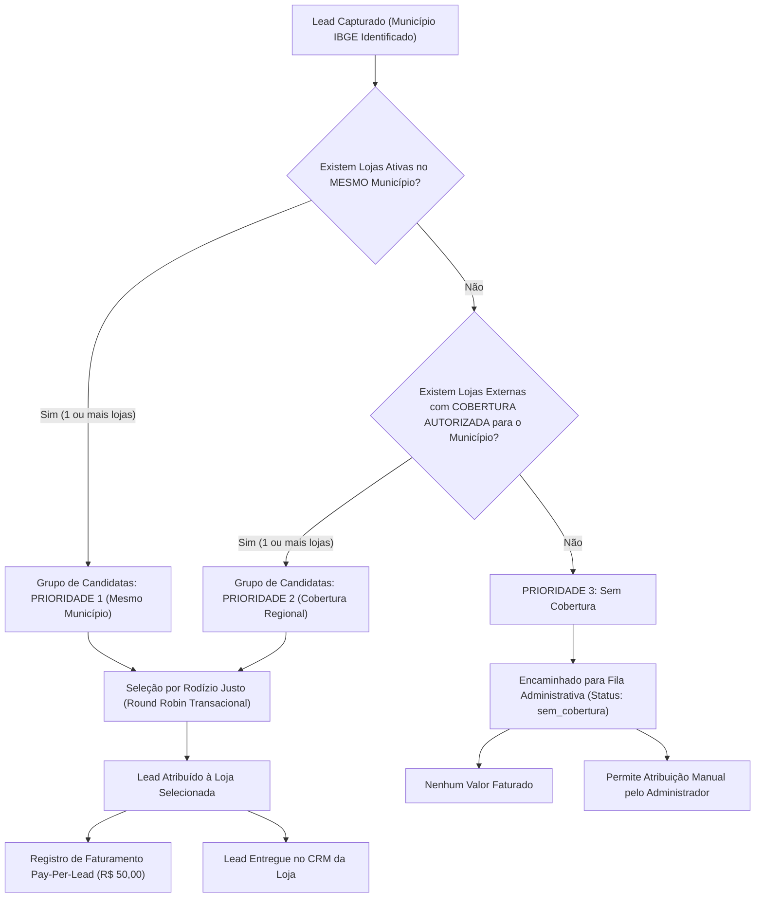
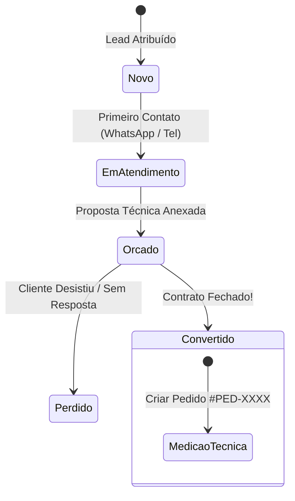

# REGRAS DE NEGÓCIO DO SAAS PLANEJAFÁCIL

**Versão:** 1.0.0  
**Status:** Especificação Oficial de Produção  

---

## 1. MOTOR INTELIGENTE DE DISTRIBUIÇÃO DE LEADS (CORE COMERCIAL)

O motor de distribuição é o núcleo comercial da plataforma, responsável por conectar consumidores a lojas parceiras de forma justa, determinística e geograficamente precisa.

### 1.1. Identificação Geográfica & Resolução de CEP
1. Ao receber o CEP informado pelo consumidor:
   - A API backend consulta o serviço de CEP (**ViaCEP / BrasilAPI**).
   - O CEP é sanitizado (apenas 8 dígitos numéricos).
   - O sistema resolve o **Código Oficial do Município do IBGE** (7 dígitos).
   - Os dados são normalizados e gravados em `ibge_cities`.
2. **Revalidação no Servidor:** O backend nunca confia na cidade enviada pelo navegador do cliente. O município de roteamento é estritamente o retornado pela resolução do CEP oficial.
3. **Tratamento de CEP Inválido/Não Localizado:** Caso o CEP não seja encontrado ou ocorra falha de rede temporária:
   - O consumidor recebe alerta no formulário para verificar o número.
   - É permitida a seleção manual assistida de Estado e Município em lista canônica do IBGE.

---

### 1.2. Regra de Prioridade Geográfica



#### PRIORIDADE 1 — Mesmo Município (Sede Local)
- O motor busca primeiramente lojas ativas que tenham o mesmo `city_ibge_code` do consumidor.
- **Exclusividade Local:** Enquanto houver ao menos **1 loja elegível sediada no mesmo município**, lojas de outras cidades estão **terminantemente proibidas** de receber o lead, mesmo que tenham declarado cobertura regional.
- **Critérios de Elegibilidade da Loja:**
  - Status cadastral = `'ativa'`.
  - Assinatura SaaS adimplente (`status = 'active'`).
  - Participação na distribuição habilitada (`is_routing_enabled = true`).

#### PRIORIDADE 2 — Cobertura de Municípios Próximos (Fallback Regional)
- Acionada **somente quando não existir nenhuma loja elegível de Prioridade 1**.
- O motor consulta a tabela `store_coverage` buscando lojas que possuam autorização expressa (`is_authorized = true`) para atender o código IBGE do consumidor.
- Lojas não autorizadas para aquela cidade específica não participam do fallback, independentemente de sua distância física.

#### PRIORIDADE 3 — Sem Cobertura (Fila Administrativa)
- Se nenhuma loja for elegível nas Prioridades 1 e 2:
  - O lead é persistido com `distribution_status = 'sem_cobertura'`.
  - Nenhum registro de cobrança (`lead_deliveries`) é criado.
  - O lead é exibido no Painel do Administrador na aba de Fila de Distribuição com destaque vermelho.
  - O Administrador pode:
    - Atribuir manualmente o lead a qualquer loja parceira mediante justificativa auditada.
    - Reprocessar a distribuição após o credenciamento de uma nova loja naquela região.

---

### 1.3. Algoritmo de Rodízio Justo (Round Robin com Bloqueio Transacional)

Dentro do grupo de lojas elegíveis (seja Prioridade 1 ou 2), a escolha da loja vencedora segue o modelo **Round Robin ponderado pela menor carga**:

1. A consulta seleciona a loja elegível com o menor contador de leads recebidos (`leads_count_cache` ou total de atribuições no período).
2. **Proteção de Concorrência (Zero Race Condition):** A seleção é protegida por transação no PostgreSQL utilizando:
   ```sql
   SELECT id, name FROM tenants
   WHERE ...
   ORDER BY leads_count_cache ASC, updated_at ASC
   LIMIT 1
   FOR UPDATE SKIP LOCKED;
   ```
3. O contador da loja vencedora é incrementado atomicamente dentro da mesma transação.
4. **Idempotência:** A submissão do lead gera um hash único baseado em `(phone, cep, created_at_minute)`. Se o mesmo formulário for submetido duas vezes em menos de 60 segundos, a segunda requisição é tratada como duplicada e não gera novo lead nem nova atribuição.

---

## 2. MOTOR DE CÁLCULO E PRECIFICAÇÃO DO SIMULADOR

O valor apresentado ao consumidor deve ser matematicamente confiável e baseado na tabela de precificação ativa (`pricing_rules`).

### 2.1. Fórmulas de Cálculo
Para cada cômodo $i$ da simulação:
1. **Comprimento Linear de Paredes com Armários:**
   $$L_i = \sqrt{\text{area\_m2}_i} \times \text{wall\_count}_i$$
2. **Altura Efetiva de Marcenaria:**
   $$H_i = \min(\text{ceiling\_height}_i, 2.60\text{m})$$
3. **Área Útil Estimada de Móveis ($m^2$):**
   $$A_i = L_i \times H_i \times 0.75$$
4. **Custo Bruto do Cômodo:**
   $$C_i = A_i \times \text{base\_m2\_price}$$
5. **Custo Total da Simulação:**
   $$C_{\text{total}} = \sum_{i=1}^{N} C_i$$
6. **Faixa Estimada de Orçamento (com Margens de Mercado):**
   $$\text{Orçamento Mínimo} = \text{Round}_{100}(C_{\text{total}} \times 0.88)$$
   $$\text{Orçamento Máximo} = \text{Round}_{100}(C_{\text{total}} \times 1.15)$$

---

## 3. CICLO DE VIDA DO CRM E CONVERSÃO EM PEDIDO ERP



### 3.1. Regras do Funil do CRM:
1. **Avanço para Orçado (Regra Flexibilizada & Assistida na Fase 5):**
   - **Novo Comportamento Homologado:** O sistema permite avançar o lead para o status `orcado` sem a obrigatoriedade estrita de um documento PDF anexado.
   - **Aviso Orientativo no Frontend:** Ao avançar sem anexo, o sistema exibe um banner orientativo recomendando a inclusão da proposta/contrato na pasta do cliente.
   - **Histórico Comercial Auditável:** A transição é registrada de forma atômica e auditável nas notas e histórico do lead.
   - **Conversão em Pedido do ERP:** Permite converter o lead em pedido, gravando o valor real contratado e inicializando a esteira de produção.
   - **Exigências Documentais Configuráveis no ERP:** O rigor documental operacional é mantido e controlado no ERP através da tabela `erp_stage_rules`, sendo configurável pelo administrador no backend.
2. **Conversão Atômica em Pedido:**
   - Ao mover para `convertido`:
     - O status do lead é atualizado.
     - Uma ordem de serviço (`#PED-XXXX`) é gerada automaticamente vinculada à loja.
     - A ordem inicia obrigatoriamente na etapa `medicao`.
     - Um evento é gravado no log de auditoria.
     - **Regra de Unicidade:** Um lead só pode gerar exatamente **um** pedido no ERP. Requisições repetidas retornam o pedido já existente.

---

## 4. CICLO DE VIDA DO ERP PÓS-VENDA & GATING DE DOCUMENTOS

A esteira do ERP possui 6 etapas rigorosamente sequenciais. O avanço de fase é condicionado à validação de documentos obrigatórios:

| Etapa | Nome da Etapa | Documento Obrigatório para Avançar | Ação do Operador |
| :---: | :--- | :--- | :--- |
| **1** | **Medição Técnica** | Ficha de Medição Técnica (PDF ou Foto das cotas) | Anexo de arquivo verificado no Storage |
| **2** | **Projeto & Aprovação** | Projeto Executivo / Render 3D aprovado | Anexo do projeto + Confirmação de aceite do cliente |
| **3** | **Produção** | Opcional (Plano de corte / Romaneio de fábrica) | Confirmação de término da usinagem e marcenaria |
| **4** | **Montagem na Obra** | Fotos da Montagem Finalizada (JPG/PNG) | Anexo de fotos reais dos móveis montados no local |
| **5** | **Entrega / Aceite** | Termo de Aceite Assinado pelo Cliente (PDF) | Anexo do documento assinado ou confirmação digital |
| **6** | **Concluído** | Nenhum (Status Terminal de Sucesso) | Pedido finalizado e arquivado com sucesso |

- **Bloqueio de Saltos:** É expressamente proibido avançar da etapa 1 direto para a etapa 4. O backend rejeita qualquer requisição que tente pular fases.

---

## 5. MONETIZAÇÃO SAAS & COBRANÇA POR PERFORMANCE (FASE 5)

1. **Fontes Independentes de Receita:**
   - **Receita Recorrente (Assinatura das Lojas):**
     - Plano Básico: R$ 119,90 / mês.
     - Plano Pro: R$ 219,90 / mês.
   - **Receita Variável (Pay-Per-Lead):**
     - R$ 50,00 por lead faturável entregue.

2. **Precificação Versionada & Congelamento de Valores:**
   - Os preços são mantidos na tabela `saas_pricing_schedules`.
   - No momento exato em que um lead é entregue à loja parceira, o preço unitário vigente é congelado no registro de `lead_deliveries`. Reajustes futuros de preços jamais alteram retroativamente cobranças passadas.
   - Operações financeiras operam com precisão decimal (`NUMERIC(10,2)`) no banco de dados e conversão segura para centavos inteiros (`toCents`) na comunicação com gateways.

3. **Distinção Rigorosa dos Ciclos do Lead:**
   - **Lead Gerado:** Registrado pelo consumidor via simulador ou cadastro avulso.
   - **Lead Atribuído:** Designado à loja pelo algoritmo de distribuição.
   - **Lead Entregue:** Transacionado e disponibilizado no painel do lojista.
   - **Lead Elegível para Cobrança:** Lead originado da plataforma entregue a uma loja credenciada.
   - **Lead Faturado:** Consolidado na fatura mensal da competência.
   - **Lead Pago:** Quitado após liquidação financeira da fatura.
   - **Lead Contestado/Cancelado:** Registrado com justificativa para auditoria administrativa sem cobrança indevida.
   - **Leads sem Cobertura ou Externos:** Não geram cobrança Pay-Per-Lead sob nenhuma hipótese.

4. **Fatura Mensal Consolidada & Idempotência:**
   - A procedure `generate_monthly_invoice` compõe a mensalidade da loja e os leads faturáveis entregues na competência (`YYYY-MM`).
   - A constraint `uq_tenant_competence` impede a emissão de faturas duplicadas caso a rotina de faturamento seja reexecutada.
   - Apenas leads com status `eligible_for_billing` são vinculados à fatura, alterando seu estado para `invoiced`.

5. **Política de Inadimplência e Suspensão Gradual:**
   - Assinaturas possuem ciclo de vida formal: `trialing`, `active`, `past_due`, `canceled`, `expired`, `suspended`.
   - Lojas com assinatura com status `suspended` são excluídas automaticamente do algoritmo de distribuição de novos leads (`route_and_assign_lead`), mantendo porém o acesso a seus dados e documentos históricos no ERP/CRM.
   - O pagamento confirmado de uma fatura pendente regulariza automaticamente a assinatura da loja para `active`.
   - **Não há suspensão automática cega:** a suspensão comercial é uma deliberação do administrador (`admin_set_store_suspension`).

6. **Modelo Operacional Sem Intermediação Financeira (Fase 5.1):**
   - **Nenhum dinheiro é movimentado pelo PlanejaFácil:** O SaaS não atua como intermediador bancário, gateway ou subadquirente (sem Asaas, Stripe ou split bancário).
   - **Pagamentos Externos Diretos:** Os lojistas efetuam o pagamento de mensalidades e leads diretamente ao titular do SaaS através de Pix ou transferência bancária externa.
   - **Declaração Administrativa Auditada:** O registro de recebimento manual (`admin_register_manual_payment`) representa uma declaração administrativa formal de quitação externa conferida pelo gestor da plataforma.
   - **Pagamentos Parciais:** Valores recebidos inferiores ao total devido mantêm a fatura com situação `'partially_paid'`, atualizando `amount_paid` e exibindo o saldo em aberto residual (`balance_due`). Somente quando `amount_paid >= total_due` a fatura é promovida para `'paid'`.
   - **Ajustes e Estornos Sem Exclusão:** Correções comerciais ou descontos são lançados através de `admin_register_invoice_adjustment` como itens de ajuste em `invoice_items`, preservando o histórico imutável.
   - **Acesso Privilegiado:** Lojistas possuem perfil exclusivamente consultivo (read-only) sobre suas cobranças e comprovantes; qualquer tentativa de simulação, liquidação ou alteração direta de planos é bloqueada no PostgreSQL (`42501`).

