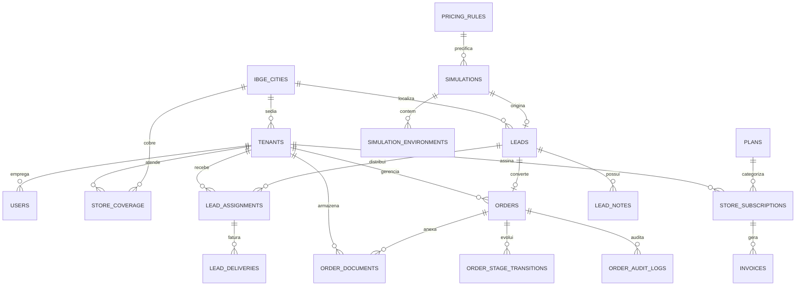

# MODELAGEM DE DADOS DO SAAS PLANEJAFÁCIL (POSTGRESQL / SUPABASE)

**Versão:** 1.1.0 (Validada em Banco Real)  
**Projeto Supabase Conectado:** `planejafacil-saas` (ID: `inqgxjdvuizsdtolrwfb`)  
**Região:** `sa-east-1` (São Paulo, Brasil)  
**Endpoint:** `https://inqgxjdvuizsdtolrwfb.supabase.co`  
**Motor de Banco:** PostgreSQL 17.6 Enterprise  
**Padrão:** Normalizado (3FN) com isolamento Multi-Tenant por Coluna (`tenant_id`) e Row Level Security (RLS) ativo em 100% das tabelas.

---

## 1. DIAGRAMA ENTIDADE-RELACIONAMENTO (DER)

---

## 2. DICIONÁRIO DE DADOS & ESPECIFICAÇÃO DAS TABELAS

### 2.1. Plataforma, Autenticação & Tenants

#### `tenants` (Lojas Parceiras Credenciadas)
Representa as marcenarias e lojas de móveis planejados contratantes do SaaS.
- `id` (UUID, PK, Default: `gen_random_uuid()`): Identificador único do tenant.
- `name` (TEXT, NOT NULL): Nome comercial da loja.
- `cnpj` (VARCHAR(18), UNIQUE, NULL): Cadastro Nacional da Pessoa Jurídica normalizado.
- `responsible_name` (TEXT, NOT NULL): Nome do responsável comercial da unidade.
- `city_ibge_code` (VARCHAR(7), NOT NULL, FK: `ibge_cities.ibge_code`): Município sede da loja.
- `city_name` (TEXT, NOT NULL): Nome da cidade sede.
- `state_uf` (VARCHAR(2), NOT NULL): Sigla do estado (ex: 'SP').
- `address` (TEXT, NULL): Logradouro, número e bairro.
- `phone` (VARCHAR(20), NOT NULL): Telefone comercial fixo ou celular.
- `whatsapp` (VARCHAR(20), NOT NULL): WhatsApp para recebimento dos leads.
- `email` (TEXT, NOT NULL): E-mail administrativo do tenant.
- `plan_tier` (VARCHAR(20), NOT NULL, Default: `'basic'`): Plano contratado (`'basic'` | `'pro'`).
- `status` (VARCHAR(20), NOT NULL, Default: `'ativa'`): Situação cadastral (`'ativa'` | `'pendente'` | `'inativa'`).
- `is_routing_enabled` (BOOLEAN, NOT NULL, Default: `true`): Flag para pausar/reativar a loja na fila de distribuição.
- `leads_count_cache` (INTEGER, NOT NULL, Default: `0`): Cache de contagem de leads para otimização do Round Robin.
- `created_at` (TIMESTAMPTZ, NOT NULL, Default: `now()`).
- `updated_at` (TIMESTAMPTZ, NOT NULL, Default: `now()`).

#### `ibge_cities` (Tabela Canônica de Municípios Brasileiros)
Garante que a correspondência geográfica use códigos oficiais, nunca strings digitadas pelo usuário.
- `ibge_code` (VARCHAR(7), PK): Código oficial do IBGE de 7 dígitos (ex: `'3552502'` para Suzano).
- `name` (TEXT, NOT NULL): Nome oficial do município.
- `state_uf` (VARCHAR(2), NOT NULL): Sigla da Unidade Federativa.
- `latitude` (NUMERIC(9,6), NULL): Coordenada geográfica.
- `longitude` (NUMERIC(9,6), NULL): Coordenada geográfica.

#### `store_coverage` (Cobertura Geográfica Adicional das Lojas)
Permite que lojas atendam municípios vizinhos além de sua sede própria.
- `id` (UUID, PK, Default: `gen_random_uuid()`).
- `tenant_id` (UUID, NOT NULL, FK: `tenants.id` ON DELETE CASCADE).
- `city_ibge_code` (VARCHAR(7), NOT NULL, FK: `ibge_cities.ibge_code`).
- `priority_level` (INTEGER, NOT NULL, Default: `2`): Prioridade de atendimento (`2` = cobertura secundária).
- `is_authorized` (BOOLEAN, NOT NULL, Default: `true`): Autorização expressa do administrador.
- **Constraint:** `UNIQUE (tenant_id, city_ibge_code)`.

#### `users` (Perfis de Usuários)
Vinculado diretamente ao `auth.users` do Supabase.
- `id` (UUID, PK, FK: `auth.users.id` ON DELETE CASCADE).
- `tenant_id` (UUID, NULL, FK: `tenants.id` ON DELETE SET NULL): Nulo para Super Admins da plataforma; preenchido para lojistas.
- `full_name` (TEXT, NOT NULL): Nome completo.
- `email` (TEXT, NOT NULL, UNIQUE).
- `role` (VARCHAR(30), NOT NULL): Papel de segurança (`'platform_admin'` | `'store_owner'` | `'store_operator'`).
- `created_at` (TIMESTAMPTZ, NOT NULL, Default: `now()`).

---

### 2.2. Simulador & Precificação

#### `pricing_rules` (Regras de Precificação Versionadas)
Garante imutabilidade histórica de orçamentos e parametrização dinâmica pelo Admin.
- `id` (UUID, PK, Default: `gen_random_uuid()`).
- `version` (INTEGER, NOT NULL, UNIQUE): Número sequencial da versão de preços.
- `base_m2_price` (NUMERIC(10,2), NOT NULL): Preço base por metro quadrado de MDF (ex: R$ 1.200,00).
- `margin_min_factor` (NUMERIC(4,3), NOT NULL, Default: `0.880`): Fator mínimo de variação ($-12\%$).
- `margin_max_factor` (NUMERIC(4,3), NOT NULL, Default: `1.150`): Fator máximo de variação ($+15\%$).
- `furniture_coverage_ratio` (NUMERIC(4,3), NOT NULL, Default: `0.750`): Coeficiente de ocupação da parede ($75\%$).
- `max_effective_height` (NUMERIC(3,2), NOT NULL, Default: `2.60`): Altura útil máxima de marcenaria em metros.
- `is_active` (BOOLEAN, NOT NULL, Default: `false`): Apenas uma versão ativa por vez.
- `created_by` (UUID, NULL, FK: `users.id`).
- `created_at` (TIMESTAMPTZ, NOT NULL, Default: `now()`).

#### `simulations` (Sessões de Orçamento do Consumidor)
- `id` (UUID, PK, Default: `gen_random_uuid()`).
- `pricing_rule_id` (UUID, NOT NULL, FK: `pricing_rules.id`).
- `client_name` (TEXT, NOT NULL).
- `client_phone` (VARCHAR(20), NOT NULL).
- `client_email` (TEXT, NULL).
- `client_cep` (VARCHAR(9), NOT NULL).
- `city_ibge_code` (VARCHAR(7), NOT NULL, FK: `ibge_cities.ibge_code`).
- `city_name` (TEXT, NOT NULL).
- `state_uf` (VARCHAR(2), NOT NULL).
- `calculated_min` (NUMERIC(10,2), NOT NULL): Orçamento mínimo computado pelo servidor.
- `calculated_max` (NUMERIC(10,2), NOT NULL): Orçamento máximo computado pelo servidor.
- `ip_address` (INET, NULL): Proteção contra abuso e rate-limiting.
- `user_agent` (TEXT, NULL).
- `created_at` (TIMESTAMPTZ, NOT NULL, Default: `now()`).

#### `simulation_environments` (Cômodos da Simulação)
- `id` (UUID, PK, Default: `gen_random_uuid()`).
- `simulation_id` (UUID, NOT NULL, FK: `simulations.id` ON DELETE CASCADE).
- `environment_type_id` (VARCHAR(30), NOT NULL): `'cozinha'`, `'quarto'`, etc.
- `name` (TEXT, NOT NULL): Ex: 'Cozinha Principal'.
- `area_m2` (NUMERIC(5,2), NOT NULL): Metragem quadrada informada.
- `ceiling_height` (NUMERIC(3,2), NOT NULL): Pé-direito do cômodo em metros.
- `wall_count` (SMALLINT, NOT NULL): Quantidade de paredes (1 a 4).
- `walls_config` (JSONB, NULL): Detalhes específicos de gaveteiros e aéreos.

---

### 2.3. Gestão Comercial (Leads, Atribuição e CRM)

#### `leads` (Entidade Comercial Unificada)
- `id` (UUID, PK, Default: `gen_random_uuid()`).
- `simulation_id` (UUID, NULL, FK: `simulations.id`): Nulo caso o lead seja originado externamente.
- `name` (TEXT, NOT NULL).
- `phone` (VARCHAR(20), NOT NULL).
- `whatsapp` (VARCHAR(20), NOT NULL).
- `email` (TEXT, NULL).
- `cep` (VARCHAR(9), NOT NULL).
- `city_ibge_code` (VARCHAR(7), NOT NULL, FK: `ibge_cities.ibge_code`).
- `city_name` (TEXT, NOT NULL).
- `state_uf` (VARCHAR(2), NOT NULL).
- `environment_summary` (TEXT, NOT NULL): Resumo textual para visualização rápida.
- `estimated_min` (NUMERIC(10,2), NOT NULL).
- `estimated_max` (NUMERIC(10,2), NOT NULL).
- `source` (VARCHAR(20), NOT NULL, Default: `'plataforma'`): `'plataforma'`, `'instagram'`, `'google'`, `'indicacao'`, `'balcao'`.
- `is_external` (BOOLEAN, NOT NULL, Default: `false`).
- `owner_tenant_id` (UUID, NULL, FK: `tenants.id`): Usado para leads externos inseridos diretamente pela loja.
- `distribution_status` (VARCHAR(30), NOT NULL, Default: `'pendente'`): `'pendente'`, `'atribuido'`, `'sem_cobertura'`, `'cancelado'`.
- `created_at` (TIMESTAMPTZ, NOT NULL, Default: `now()`).

#### `lead_assignments` (Atribuição do Lead a uma Loja)
Permite que o lead pertença à plataforma e seja entregue a um tenant específico (preparado para multi-entrega futura).
- `id` (UUID, PK, Default: `gen_random_uuid()`).
- `lead_id` (UUID, NOT NULL, FK: `leads.id` ON DELETE CASCADE).
- `tenant_id` (UUID, NOT NULL, FK: `tenants.id` ON DELETE CASCADE).
- `assignment_reason` (VARCHAR(30), NOT NULL): `'same_city_round_robin'`, `'nearby_coverage_fallback'`, `'admin_manual_assignment'`.
- `status` (VARCHAR(20), NOT NULL, Default: `'novo'`): Status no CRM do lojista (`'novo'`, `'em_atendimento'`, `'orcado'`, `'convertido'`, `'perdido'`).
- `loss_reason` (TEXT, NULL): Motivo da perda quando status = `'perdido'`.
- `assigned_at` (TIMESTAMPTZ, NOT NULL, Default: `now()`).
- `updated_at` (TIMESTAMPTZ, NOT NULL, Default: `now()`).
- **Constraint:** `UNIQUE (lead_id, tenant_id)`.

#### `lead_deliveries` (Registro de Faturamento Pay-Per-Lead)
Registra eventos contábeis imutáveis para cobrança de R$ 50,00 por lead comercial entregue.
- `id` (UUID, PK, Default: `gen_random_uuid()`).
- `assignment_id` (UUID, NOT NULL, FK: `lead_assignments.id` ON DELETE CASCADE, UNIQUE).
- `tenant_id` (UUID, NOT NULL, FK: `tenants.id`).
- `unit_cost` (NUMERIC(10,2), NOT NULL, Default: `50.00`): Custo configurado do lead.
- `is_billable` (BOOLEAN, NOT NULL, Default: `true`): Faturável (falso para testes ou leads externos).
- `invoice_id` (UUID, NULL): Vinculação com a fatura mensal.
- `created_at` (TIMESTAMPTZ, NOT NULL, Default: `now()`).

#### `lead_notes` (Histórico de Interações do CRM)
- `id` (UUID, PK, Default: `gen_random_uuid()`).
- `assignment_id` (UUID, NOT NULL, FK: `lead_assignments.id` ON DELETE CASCADE).
- `tenant_id` (UUID, NOT NULL, FK: `tenants.id`).
- `author_id` (UUID, NOT NULL, FK: `users.id`).
- `note_text` (TEXT, NOT NULL).
- `created_at` (TIMESTAMPTZ, NOT NULL, Default: `now()`).

---

### 2.4. ERP Pós-Venda & Ordens de Produção

#### `orders` (Ordens de Serviço e Produção do Lojista)
Criado automaticamente quando um lead é marcado como `convertido`.
- `id` (UUID, PK, Default: `gen_random_uuid()`).
- `order_number` (VARCHAR(20), UNIQUE, NOT NULL): Ex: `'PED-4092'`.
- `tenant_id` (UUID, NOT NULL, FK: `tenants.id` ON DELETE CASCADE).
- `lead_assignment_id` (UUID, NOT NULL, FK: `lead_assignments.id`, UNIQUE): Garante 1 pedido por lead.
- `client_name` (TEXT, NOT NULL).
- `client_phone` (VARCHAR(20), NOT NULL).
- `delivery_address` (TEXT, NOT NULL).
- `environment_description` (TEXT, NOT NULL).
- `total_value` (NUMERIC(10,2), NOT NULL): Valor final fechado no contrato.
- `current_stage` (VARCHAR(30), NOT NULL, Default: `'medicao'`): `'medicao'`, `'projeto_aprovacao'`, `'producao'`, `'montagem'`, `'entrega_aceite'`, `'concluido'`.
- `created_at` (TIMESTAMPTZ, NOT NULL, Default: `now()`).
- `updated_at` (TIMESTAMPTZ, NOT NULL, Default: `now()`).

#### `order_documents` (Pasta Digital de Documentos do ERP)
Metadados dos arquivos físicos armazenados com criptografia no Supabase Storage.
- `id` (UUID, PK, Default: `gen_random_uuid()`).
- `order_id` (UUID, NOT NULL, FK: `orders.id` ON DELETE CASCADE).
- `tenant_id` (UUID, NOT NULL, FK: `tenants.id` ON DELETE CASCADE).
- `stage` (VARCHAR(30), NOT NULL): Etapa associada (`'contrato'`, `'medicao'`, `'projeto'`, `'producao'`, `'montagem'`, `'aceite'`).
- `file_path` (TEXT, NOT NULL): Caminho do objeto no bucket privado (ex: `orders/{order_id}/medicao_2026.pdf`).
- `file_name` (TEXT, NOT NULL): Nome original do arquivo.
- `file_size_bytes` (BIGINT, NOT NULL).
- `mime_type` (VARCHAR(100), NOT NULL).
- `uploaded_by` (UUID, NOT NULL, FK: `users.id`).
- `created_at` (TIMESTAMPTZ, NOT NULL, Default: `now()`).

#### `order_stage_transitions` & `order_audit_logs` (Linha do Tempo Imutável)
Registra quem avançou a etapa do pedido com hora exata e detalhes técnicos.
- `id` (UUID, PK, Default: `gen_random_uuid()`).
- `order_id` (UUID, NOT NULL, FK: `orders.id` ON DELETE CASCADE).
- `tenant_id` (UUID, NOT NULL, FK: `tenants.id` ON DELETE CASCADE).
- `user_id` (UUID, NOT NULL, FK: `users.id`).
- `user_name` (TEXT, NOT NULL).
- `user_role` (TEXT, NOT NULL).
- `action_message` (TEXT, NOT NULL).
- `stage_from` (VARCHAR(30), NULL).
- `stage_to` (VARCHAR(30), NULL).
- `created_at` (TIMESTAMPTZ, NOT NULL, Default: `now()`).

---

### 2.5. Financeiro SaaS & Monetização (Fase 5 Implementada)

#### `saas_pricing_schedules` (Tabela de Precificação Versionada)
- `id` (UUID, PK, Default: `gen_random_uuid()`).
- `plan_tier` (VARCHAR(20), NOT NULL): `'basic'`, `'pro'`.
- `monthly_price` (NUMERIC(10,2), NOT NULL): R$ 119,90 ou R$ 219,90.
- `lead_price` (NUMERIC(10,2), NOT NULL): Preço por lead faturável (R$ 50,00).
- `features` (JSONB, NOT NULL, Default: `'[]'::jsonb`).
- `version` (INT, NOT NULL, Default: `1`).
- `is_active` (BOOLEAN, NOT NULL, Default: `true`).
- `effective_from` (TIMESTAMPTZ, NOT NULL, Default: `now()`).
- `effective_until` (TIMESTAMPTZ, NULL).
- `created_at` (TIMESTAMPTZ, NOT NULL, Default: `now()`).

#### `store_subscriptions` (Ciclo de Vida de Assinaturas das Lojas)
- `id` (UUID, PK, Default: `gen_random_uuid()`).
- `tenant_id` (UUID, NOT NULL, FK: `tenants.id` ON DELETE CASCADE, UNIQUE).
- `plan_tier` (VARCHAR(20), NOT NULL): `'basic'`, `'pro'`.
- `contracted_monthly_price` (NUMERIC(10,2), NOT NULL).
- `status` (VARCHAR(20), NOT NULL, Default: `'active'`): CHECK (`status IN ('trialing', 'active', 'past_due', 'canceled', 'expired', 'suspended')`).
- `started_at` (TIMESTAMPTZ, NOT NULL, Default: `now()`).
- `next_billing_at` (TIMESTAMPTZ, NOT NULL).
- `canceled_at` (TIMESTAMPTZ, NULL).
- `gateway_customer_id` (TEXT, NULL).
- `gateway_subscription_id` (TEXT, NULL).
- `created_at` / `updated_at` (TIMESTAMPTZ, NOT NULL).

#### `subscription_history` (Trilha de Auditoria de Assinaturas)
- `id` (UUID, PK, Default: `gen_random_uuid()`).
- `tenant_id` (UUID, NOT NULL, FK: `tenants.id` ON DELETE CASCADE).
- `action` (VARCHAR(50), NOT NULL): `'created'`, `'plan_change'`, `'renewed'`, `'status_change'`.
- `previous_plan` (VARCHAR(20), NULL).
- `new_plan` (VARCHAR(20), NOT NULL).
- `previous_price` / `new_price` (NUMERIC(10,2), NULL).
- `reason` (TEXT, NULL).
- `actor_id` (UUID, NULL).
- `created_at` (TIMESTAMPTZ, NOT NULL, Default: `now()`).

#### `lead_deliveries` (Eventos Faturáveis de Lead com Preço Congelado)
- `id` (UUID, PK, Default: `gen_random_uuid()`).
- `assignment_id` (UUID, NOT NULL, UNIQUE, FK: `lead_assignments.id` ON DELETE CASCADE).
- `tenant_id` (UUID, NOT NULL, FK: `tenants.id`).
- `unit_cost` (NUMERIC(10,2), NOT NULL, Default: `50.00`): Preço congelado no momento da entrega.
- `is_billable` (BOOLEAN, NOT NULL, Default: `true`): Falso para leads externos/manuais.
- `pricing_schedule_id` (UUID, NULL, FK: `saas_pricing_schedules.id`).
- `delivery_status` (VARCHAR(30), NOT NULL, Default: `'delivered'`): CHECK (`delivery_status IN ('delivered', 'eligible_for_billing', 'invoiced', 'paid', 'disputed', 'canceled', 'refunded')`).
- `invoice_id` (UUID, NULL, FK: `invoices.id` ON DELETE SET NULL).
- `dispute_reason` (TEXT, NULL).
- `disputed_at` / `resolved_at` (TIMESTAMPTZ, NULL).
- `idempotency_key` (TEXT, UNIQUE, NULL).
- `created_at` (TIMESTAMPTZ, NOT NULL, Default: `now()`).

#### `invoices` (Faturas Mensais Consolidadas)
- `id` (UUID, PK, Default: `gen_random_uuid()`).
- `invoice_number` (VARCHAR(50), NOT NULL, UNIQUE): Formato `'FAT-YYYYMM-XXXX'`.
- `tenant_id` (UUID, NOT NULL, FK: `tenants.id`).
- `competence_month` (VARCHAR(7), NOT NULL): Formato `'YYYY-MM'`.
- `subscription_amount` (NUMERIC(10,2), NOT NULL, Default: `0.00`).
- `leads_usage_amount` (NUMERIC(10,2), NOT NULL, Default: `0.00`).
- `adjustments_amount` (NUMERIC(10,2), NOT NULL, Default: `0.00`).
- `total_due` (NUMERIC(10,2), NOT NULL, Default: `0.00`).
- `due_date` (TIMESTAMPTZ, NOT NULL).
- `status` (VARCHAR(30), NOT NULL, Default: `'pending'`): CHECK (`status IN ('draft', 'pending', 'paid', 'past_due', 'canceled', 'refunded')`).
- `paid_at` (TIMESTAMPTZ, NULL).
- `payment_method` (VARCHAR(30), NULL): `'pix'`, `'boleto'`, `'credit_card'`.
- `gateway_charge_id` (TEXT, NULL).
- `gateway_invoice_url` (TEXT, NULL).
- `CONSTRAINT uq_tenant_competence UNIQUE (tenant_id, competence_month)`.

#### `invoice_items` (Detalhamento Itemizado das Faturas)
- `id` (UUID, PK, Default: `gen_random_uuid()`).
- `invoice_id` (UUID, NOT NULL, FK: `invoices.id` ON DELETE CASCADE).
- `item_type` (VARCHAR(30), NOT NULL): CHECK (`item_type IN ('subscription', 'lead_fee', 'adjustment', 'credit')`).
- `description` (TEXT, NOT NULL).
- `quantity` (INT, NOT NULL, Default: `1`).
- `unit_price` (NUMERIC(10,2), NOT NULL).
- `total_price` (NUMERIC(10,2), NOT NULL).
- `origin_reference_id` (UUID, NULL).
- `created_at` (TIMESTAMPTZ, NOT NULL, Default: `now()`).

#### `webhook_events` (Ingestão Segura e Anti-Replay de Webhooks — Isolado / Inativo em Produção)
- `id` (UUID, PK, Default: `gen_random_uuid()`).
- `gateway_provider` (VARCHAR(50), NOT NULL): `'asaas'`, `'stripe'`, `'sandbox'`.
- `event_id` (VARCHAR(150), NOT NULL): ID do evento no provedor.
- `event_type` (VARCHAR(100), NOT NULL).
- `payload` (JSONB, NOT NULL).
- `status` (VARCHAR(30), NOT NULL, Default: `'received'`): CHECK (`status IN ('received', 'processed', 'duplicate_ignored', 'failed')`).
- `error_message` (TEXT, NULL).
- `processed_at` (TIMESTAMPTZ, NULL).
- `created_at` (TIMESTAMPTZ, NOT NULL, Default: `now()`).
- `CONSTRAINT uq_gateway_event UNIQUE (gateway_provider, event_id)`.

#### `invoice_payments` (Comprovantes de Recebimento Manual — Fase 5.1)
- `id` (UUID, PK, Default: `gen_random_uuid()`).
- `invoice_id` (UUID, NOT NULL, FK -> `invoices(id)` ON DELETE CASCADE).
- `tenant_id` (UUID, NOT NULL, FK -> `tenants(id)` ON DELETE CASCADE).
- `amount_paid` (NUMERIC(10,2), NOT NULL, CHECK `amount_paid > 0`).
- `payment_date` (TIMESTAMPTZ, NOT NULL, Default: `now()`).
- `payment_method` (VARCHAR(30), NOT NULL): CHECK (`payment_method IN ('pix', 'transferencia', 'dinheiro', 'boleto_externo', 'outro')`).
- `external_reference` (TEXT, NULL): Identificador externo (ex: Pix End-to-End ID, número de TED/DOC ou comprovante).
- `notes` (TEXT, NULL): Observações registradas pelo administrador.
- `registered_by` (UUID, FK -> `auth.users(id)`): Identificação do administrador responsável pelo lançamento.
- `idempotency_key` (TEXT, UNIQUE, NULL): Chave para garantia estrita contra pagamentos manuais duplicados.
- `created_at` (TIMESTAMPTZ, NOT NULL, Default: `now()`).
- *RLS:* Leitura restrita ao tenant proprietário e `platform_admin`. Escrita/inserção restrita exclusivamente a `platform_admin`.

#### Adequações em Tabelas Existentes (Fase 5.1)
- **`invoices`:**
  - `amount_paid` (NUMERIC(10,2), NOT NULL, Default: `0.00`): Total acumulado pago na fatura.
  - `status` CHECK atualizado: `('draft', 'pending', 'partially_paid', 'paid', 'past_due', 'overdue', 'canceled', 'refunded')`.
- **`store_subscriptions`:**
  - `billing_due_day` (INTEGER, NOT NULL, Default: `10`, CHECK `billing_due_day BETWEEN 1 AND 31`): Dia fixo do mês para vencimento da fatura da loja.
  - `suspension_reason` (TEXT, NULL): Justificativa comercial da suspensão manual.
  - `suspended_at` (TIMESTAMPTZ, NULL): Timestamp em que a loja foi suspensa administrativamente.
  - `CONSTRAINT store_subscriptions_tenant_id_unique UNIQUE (tenant_id)`.

#### `erp_stage_rules` (Regras de Gating Configuráveis do ERP)
- `stage` (VARCHAR(30), PK): `'medicao'`, `'projeto_aprovacao'`, `'producao'`, `'montagem'`, `'entrega_aceite'`.
- `document_required` (BOOLEAN, NOT NULL, Default: `true`).
- `description` (TEXT, NOT NULL).
- `updated_at` (TIMESTAMPTZ, NOT NULL, Default: `now()`).

---

### 2.6. Stored Procedures Financeiras Oficiais (PostgreSQL)

1. `generate_monthly_invoice(p_tenant_id UUID, p_competence_month VARCHAR(7))`
   - Agrupa mensalidade e eventos `lead_deliveries` elegíveis não faturados.
   - Aplica constraint de unicidade por competência para garantir idempotência estrita.
   - Vincula os `lead_deliveries` gerados à fatura com status `'invoiced'`.

2. `admin_register_manual_payment(p_invoice_id UUID, p_amount_paid NUMERIC, p_payment_date TIMESTAMPTZ, p_payment_method VARCHAR, p_notes TEXT, p_external_reference TEXT, p_idempotency_key TEXT)`
   - Operação administrativa restrita (`is_platform_admin()`).
   - Registra lançamento em `invoice_payments`, atualiza `invoices.amount_paid`, recalcula saldo em aberto e define status (`'partially_paid'` ou `'paid'`).
   - Quando atinge quitação integral (`amount_paid >= total_due`), atualiza entregas em `lead_deliveries` para `'paid'` e regulariza lojas `'past_due'` para `'active'`.
   - Protegido por chave de idempotência contra cliques repetidos.

3. `admin_register_invoice_adjustment(p_invoice_id UUID, p_adjustment_amount NUMERIC, p_description TEXT)`
   - Permite lançamentos auditados de descontos (valores negativos) ou acréscimos (positivos).
   - Insere item do tipo `'adjustment'` em `invoice_items` e recalcula `total_due` e status da fatura.

4. `admin_set_store_suspension(p_tenant_id UUID, p_suspended BOOLEAN, p_reason TEXT)`
   - Operação administrativa restrita para suspender ou reativar uma loja.
   - Atualiza `store_subscriptions.status` (`'suspended'` / `'active'`), grava em `subscription_history` e reflete imediatamente no motor de roteamento (`is_routing_enabled`).

5. `admin_save_store_and_subscription(p_store_id UUID, p_name TEXT, p_cnpj VARCHAR, p_responsible_name TEXT, p_city_ibge_code VARCHAR, p_city_name TEXT, p_state_uf VARCHAR, p_phone VARCHAR, p_whatsapp VARCHAR, p_email TEXT, p_plan_tier VARCHAR, p_contracted_price NUMERIC, p_billing_due_day INT, p_is_routing_enabled BOOLEAN, p_covered_cities VARCHAR[])`
   - Cadastra nova loja parceira ou edita loja existente com vinculação de plano (`basic` / `pro`), preço acordado, dia de vencimento contratual e cobertura regional.

6. `process_simulated_payment(p_invoice_id UUID, p_payment_method VARCHAR(30))`
   - **Restrito estritamente a administradores:** Lojistas comuns são bloqueados com erro `42501`. Mantido isolado para validações administrativas controladas.

7. `get_admin_financial_metrics()`
   - Computa métricas em tempo real diretamente do banco: MRR, ARR, faturamento emitido, total recebido via registros manuais, saldo em aberto, inadimplência, faturas a vencer nos próximos 7 e 30 dias e histórico de recebimentos recentes.

8. `get_store_financial_overview(p_tenant_id UUID)`
   - Retorna a visão privada da loja: plano atual, valor contratado, dia de vencimento, faturas emitidas com saldo devedor discriminado e comprovantes de recebimento manual auditados.

