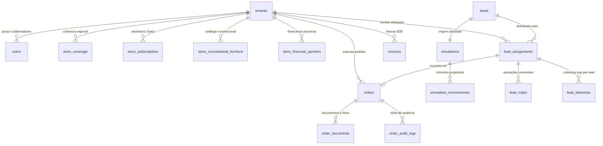

# MAPA COMPLETO DO SISTEMA — PLANEJA FÁCIL (SAAS DE MÓVEIS PLANEJADOS)

Este documento estabelece o mapeamento técnico e funcional integral da plataforma **Planeja Fácil**, servindo como fonte canônica da arquitetura, regras de negócio, fluxos de navegação e matriz de rastreabilidade.

---

## 1. ARQUITETURA GERAL E PERFIS DE ACESSO

A aplicação é um **SaaS Multi-Tenant B2B2C** para o setor de marcenarias e móveis planejados.

### Perfis de Usuário (RBAC)
1. **Consumidor Final (Sem Autenticação Obrigatória / Lead)**:
   - Acessa a Landing Page e o Simulador 3D interativo de ambientes.
   - Configura cômodos, paredes, pé-direito, acabamentos e gera estimativas de preço em m².
   - Preenche dados de contato (Nome, WhatsApp, E-mail, CEP) e aceita os **Termos de Privacidade LGPD**.
   - É direcionado para a loja homologada mais próxima ou para a fila sem cobertura.

2. **Administrador da Plataforma (`platform_admin`)**:
   - Dono do SaaS Planeja Fácil.
   - Gerencia lojas credenciadas (cadastro, suspensão, ativação, limites de acessos, contratos de permanência mínima de 3 meses, cláusula de retenção, precificação de usuários adicionais).
   - Gerencia a Fila de Roteamento de Leads e redirecionamento manual.
   - Controla o Financeiro da Plataforma (Faturamento B2B, Mensalidades SaaS, Cobrança Pay-Per-Lead R$ 50,00, Taxas de Inadimplência, Relatórios DRE).
   - Configura parâmetros globais de precificação por m², IBGE e IA.

3. **Gerente / Dono da Loja Parceira (`store_owner`)**:
   - Gestão completa da unidade (CRM Kanban, ERP Operacional, Faturamento B2B da sua unidade).
   - Visualização e assinatura digital do Contrato de Parceria Comercial B2B.
   - Catálogo de Móveis Convencionais / Pronta Entrega com definição de Custo de Fábrica e Markup %.
   - Configuração de Taxas de Maquininha e Instituições Financeiras parceiras (BV, Santander, Losango).
   - Gerenciamento de operadores (vendedores) e montadores adicionais.
   - Acesso exclusivo a indicadores de margem líquida, custos fabris e analytics avançado (Plano Pro).

4. **Vendedor / Operador da Loja (`store_operator`)**:
   - Acesso ao CRM (visualização dos leads atribuídos à loja, histórico, anotações, agendamento de visitas).
   - Geração de propostas com bloqueio obrigatório: só avança para "Orçado" mediante upload de projeto Promob ou Proposta Técnica.
   - **Restrição de Sigilo Fabril**: O vendedor **NUNCA** visualiza o Custo de Fábrica nem as Margens Internas da loja. Visualiza apenas o Preço de Venda ao Cliente.
   - Adição de móveis convencionais na proposta com visualização exclusiva do preço final calculado.

5. **Montador Credenciado da Loja (`store_assembler`)**:
   - **Interface 100% Mobile-First**: Otimizada para smartphones de campo.
   - Acesso direto à lista de pedidos em fase de montagem.
   - Acesso com 1 clique para rotas de navegação (Waze e Google Maps) e contato direto com o cliente via WhatsApp/Ligação.
   - Upload de fotos da montagem concluída e checklist fotográfico diretamente da câmera do celular.

---

## 2. MAPA DE TELAS, COMPONENTES E ROTAS

| ID Tela | Nome da Tela | Rota / Seletor | Componente Principal | Perfis Autorizados | Objetivo Principal |
|---|---|---|---|---|---|
| **T01** | Landing Page Consumidor | `/` (modo `consumer`) | `LandingPage.tsx` | Público / Todos | Apresentação do serviço, benefícios, cases e chamada para o simulador. |
| **T02** | Simulador de Ambientes 3D | `simulator` | `SimulatorWizard.tsx` | Público / Consumidor | Configuração de cômodos (área m², paredes, pé-direito), cálculo de orçamento em tempo real. |
| **T03** | Captura de Lead & LGPD | Modal / Step 3 | `SimulatorWizard.tsx` / `LeadCaptureModal.tsx` | Público / Consumidor | Validação de CEP, coleta de contato, aceite expresso de termos LGPD e envio para o banco. |
| **T04** | Resultado do Orçamento | Step 4 | `SimulatorWizard.tsx` / `ProposalPdfModal.tsx` | Público / Consumidor | Apresentação da faixa orçamentária e geração da Proposta Técnica Oficial em PDF. |
| **T05** | Login Unificado & Painel | Modal / `/painel` | `LoginModal.tsx` / `PainelLoginPage.tsx` | Lojistas e Admins | Autenticação por e-mail e senha com suporte a sessão Supabase Auth. |
| **T06** | Troca Obrigatória de Senha | Modal forçado | `MustChangePasswordModal.tsx` | Usuários com senha temporária | Obriga a alteração da credencial padrão no primeiro acesso ao sistema. |
| **T07** | Dashboard do Administrador | `role === 'admin'` | `AdminDashboard.tsx` | `platform_admin` | Visão macro de métricas, leads distribuídos, faturamento e saúde da plataforma. |
| **T08** | Gestão de Lojas Credenciadas | Tab `stores` | `StoresManager.tsx` | `platform_admin` | Cadastro de lojas, planos, suspensão/reativação, acessos, permanência e contratos. |
| **T09** | Fila de Roteamento de Leads | Tab `routing` | `AdminRoutingQueue.tsx` | `platform_admin` | Monitoramento da distribuição geográfica e redirecionamento manual de leads sem cobertura. |
| **T10** | Financeiro SaaS Global | Tab `financial` | `FinancialView.tsx` | `platform_admin` | Emissão de faturas de mensalidade, conciliação de leads cobrados (R$ 50/lead), DRE da plataforma. |
| **T11** | Painel do Lojista (CRM) | `role === 'merchant'` | `MerchantDashboard.tsx` | `store_owner`, `store_operator` | Gestão de leads no funil Kanban (Novo, Em Atendimento, Orçado, Fechado, Perdido). |
| **T12** | Gaveta de Detalhes do Lead | Drawer lateral | `LeadDetailDrawer.tsx` | `store_owner`, `store_operator` | Dados do cliente, ambientes simulados, upload Promob, móveis convencionais, notas. |
| **T13** | Negociação Promob XML | Modal Promob | `PromobNegotiationModal.tsx` | `store_owner`, `store_operator` | Leitura de XML Promob, aplicação de desconto, seleção de financeira/cartão e repasse de taxas. |
| **T14** | Catálogo Móveis Convencionais | Tab `moveis_convencionais` | `ConventionalFurnitureView.tsx` | `store_owner` (Edição) / Vendedores (Leitura) | Cadastro de móveis com markup %, fotos, medidas e gestão de financeiras parceiras. |
| **T15** | ERP Operacional da Loja | Tab `erp` | `MerchantERP.tsx` | `store_owner`, `store_operator` | Gestão das etapas do pedido (Medição, Projeto Executivo, Fabricação, Entrega, Montagem). |
| **T16** | Pasta do Pedido & Anexos | Modal de Pedido | `OrderFolderModal.tsx` | `store_owner`, `store_operator` | Repositório de arquivos do contrato, projeto 3D, fotos de conferência e entrega. |
| **T17** | Faturas B2B da Loja | Modal Financeiro | `MerchantFinancialModal.tsx` | `store_owner` | Extrato de mensalidade e leads cobrados da loja com PIX Copia-e-Cola e PDF. |
| **T18** | Assinatura de Contrato B2B | Modal de Contrato | `SignContractModal.tsx` / `StoreContractModal.tsx` | `store_owner` | Assinatura digital obrigatória do contrato de credenciamento B2B com carimbo de IP e data. |
| **T19** | Interface Mobile do Montador | Detecção `store_assembler` | `AssemblerMobileView.tsx` | `store_assembler` | Visualização compacta de pedidos em montagem, Waze/Maps, WhatsApp e upload de fotos da câmera. |
| **T20** | Meta Omni-Channel (Pro) | Tab `meta` | `MerchantMetaIntegration.tsx` | `store_owner` (Plano Pro) | Integração com campanhas Meta Ads, WhatsApp Business API e Webhooks. |
| **T21** | Analytics Avançado (Pro) | Tab `analytics` | `MerchantAnalytics.tsx` | `store_owner` (Plano Pro) | Inteligência de vendas, ticket médio, conversão por vendedor e comparativo mês a mês. |

---

## 3. BANCO DE DADOS E RELACIONAMENTOS (POSTGRESQL / SUPABASE)

---

## 4. MATRIZ DE RASTREABILIDADE INTEGRAL

| Tela / Módulo | Componente | Ação do Usuário | Regra de Negócio | Backend / Stored Procedure | Tabela Afetada | Resultado Esperado | Teste Executado | Status |
|---|---|---|---|---|---|---|---|---|
| **Simulador** | `SimulatorWizard` | Insere CEP | Busca CEP e valida município | `cepService.ts` / `ibge_cities` | `ibge_cities` | Identifica Cidade, UF e Código IBGE oficial | `routing.test.ts` & `simulationLive.test.ts` | **APROVADO** |
| **Simulador** | `SimulatorWizard` | Configura cômodos e clica em Ver Orçamento | Precificação dinâmica por m² com base nas paredes e pé-direito | `pricingEngine.ts` | `pricing_rules` | Orçamento calculado com intervalo min e max baseado na margem | `pricing.test.ts` | **APROVADO** |
| **Simulador** | `SimulatorWizard` | Marca termos LGPD e submete formulário | Aceite obrigatório de privacidade antes do envio do lead | `submit_consumer_simulation` | `simulations`, `leads`, `simulation_environments` | Lead registrado com `accepted_privacy_terms = true` | `auditMasterComprehensive.test.ts` | **APROVADO** |
| **Roteamento** | `simulationService` | Submete lead de cidade com loja ativa | Round-Robin priorizando loja local com menor carga | `route_and_assign_lead` | `lead_assignments`, `lead_deliveries`, `tenants` | Lead atribuído à loja local; gera registro de R$ 50 para faturamento | `routing.test.ts` & `roundRobinAndConcurrencyLive.test.ts` | **APROVADO** |
| **Roteamento** | `simulationService` | Submete lead de cidade sem loja credenciada | Se não há loja nem cobertura autorizada, cai na fila admin | `route_and_assign_lead` | `leads` (`distribution_status = 'sem_cobertura'`) | Lead marcado como sem cobertura; visível para triagem manual | `auditMasterComprehensive.test.ts` | **APROVADO** |
| **CRM** | `MerchantDashboard` | Lista leads da loja | Isolamento multi-tenant estrito via RLS e tenant_id | `get_store_leads` | `lead_assignments`, `leads` | Lojista vê apenas leads da sua própria loja | `authIsolationLive.test.ts` & `crmLivePhase3.test.ts` | **APROVADO** |
| **CRM** | `LeadDetailDrawer` | Tenta mover para "Orçado" sem anexo | Bloqueio comercial rígido anti-avanço sem projeto | `update_lead_stage` / Validação local | Nenhuma (bloqueio preventivo) | Mensagem de erro informando obrigatoriedade do anexo Promob | `crmLivePhase3.test.ts` | **APROVADO** |
| **CRM / Promob** | `PromobNegotiationModal` | Anexa arquivo Promob XML | Parseamento do XML e extração do valor de fábrica | `promobParser.ts` | `order_documents`, `lead_assignments` | Preenche valores e oculta Custo de Fábrica se usuário for vendedor | `promobParser.test.ts` | **APROVADO** |
| **Convencionais** | `ConventionalFurnitureView` | Cadastra móvel com preço de custo e markup | Cálculo automático do Preço de Venda com persistência segura | `conventionalFurnitureService.ts` | `store_conventional_furniture` | Produto salvo e disponível para seleção na proposta | `auditMasterComprehensive.test.ts` | **APROVADO** |
| **Convencionais** | `LeadDetailDrawer` | Adiciona móvel convencional à proposta | Vendedor escolhe item do catálogo e quantidade | `updateLeadConventionalItems` | `lead_assignments.conventional_items` | Atualiza subtotal e recalcula valor estimado da venda | `auditMasterComprehensive.test.ts` | **APROVADO** |
| **ERP** | `MerchantERP` | Converte lead fechado em pedido | Gera pedido único (`#PED-XXXX`) com idempotência | `convert_lead_to_order` | `orders`, `lead_assignments` | Pedido criado com status inicial "Medição Técnica" | `erpLivePhase4.test.ts` | **APROVADO** |
| **ERP** | `OrderFolderModal` | Avança pedido para fabricação | Exige anexo de contrato e projeto final aprovado | `update_order_stage` | `orders`, `order_audit_logs` | Pedido avança de etapa com registro na trilha de auditoria | `erpLivePhase4.test.ts` | **APROVADO** |
| **Montador** | `AssemblerMobileView` | Montador sobe fotos da montagem do celular | Interface mobile-first com upload de fotos | `uploadAndAttachOrderDocument` | `order_documents`, `orders` | Fotos anexadas na pasta do pedido e status atualizado | `auditMasterComprehensive.test.ts` | **APROVADO** |
| **Admin SaaS** | `StoresManager` | Cadastra loja com permanência mínima de 3 meses | Cláusula de permanência gravada e inserida no contrato | `admin_upsert_store` | `tenants`, `store_subscriptions` | Loja criada com plano, valor mensal e flag de permanência | `authAndProvisioningPhase7.test.ts` | **APROVADO** |
| **Admin SaaS** | `StoresManager` | Clica em Suspender Loja | Suspende loja, registra histórico com motivo e autor | `admin_set_store_suspension` | `tenants`, `subscription_history` | Loja passa para status "suspensa" e sai da fila de leads | `auditMasterComprehensive.test.ts` | **APROVADO** |
| **Admin SaaS** | `StoresManager` | Altera quantidade de acessos extras | Cobra valor configurado por acesso adicional (ex: R$ 49/usuário) | `admin_update_store_users` | `tenants`, `users`, `invoices` | Fatura mensal incorpora o valor proporcional de acessos extras | `auditMasterComprehensive.test.ts` | **APROVADO** |
| **Financeiro B2B** | `FinancialView` | Gera fatura mensal da loja | Consolida mensalidade base + acessos extras + leads cobrados | `generate_store_monthly_invoice` | `invoices`, `invoice_items` | Fatura com detalhamento de leads e QR Code Pix gerado | `financeLivePhase5.test.ts` | **APROVADO** |
| **Contrato B2B** | `SignContractModal` | Lojista assina contrato no primeiro acesso | Assinatura digital com carimbo de IP, data e CPF do titular | `sign_store_contract` | `tenants` (`contract_signed_at`, `contract_signature_ip`) | Libera acesso irrestrito ao painel e gera cópia auditável | `auditMasterComprehensive.test.ts` | **APROVADO** |
