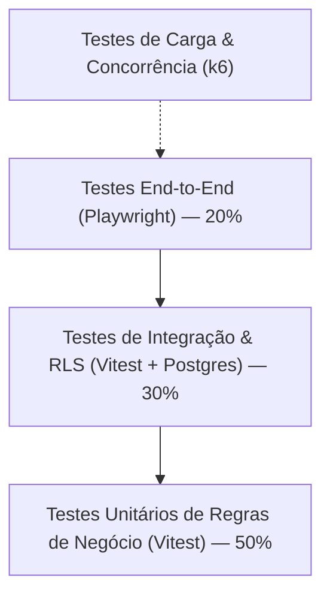

# PLANO DE TESTES AUTOMATIZADOS E CRITÉRIOS DE ACEITE — PLANEJAFÁCIL

**Versão:** 1.0.0  
**Frameworks:** Vitest (Unitários & Integração), Playwright (E2E), k6 (Carga), Supabase Test Helpers / pgTAP (RLS)  

---

## 1. PIRÂMIDE DE TESTES DA PLATAFORMA

---

## 2. MATRIZ DOS 18 CENÁRIOS OBRIGATÓRIOS DE PRODUÇÃO

### 2.1. Cenários Comerciais (Motor de Roteamento)

| Teste | Cenário | Condições Iniciais | Ação Executada | Resultado Esperado & Critério de Aceite |
| :---: | :--- | :--- | :--- | :--- |
| **TEST-01** | **Prioridade 1: Exclusividade Local** | 2 lojas ativas em Suzano (`store-A`, `store-B`) e 1 loja ativa em São Paulo (`store-C`). | Consumidor com CEP de Suzano submete orçamento. | O lead é atribuído **obrigatoriamente** à `store-A` ou `store-B`. A `store-C` não participa da disputa. |
| **TEST-02** | **Sequência Justa de Rodízio (Round Robin)** | Lojas `store-A` e `store-B` com contador de leads zerado. | Três consumidores consecutivos de Suzano enviam leads. | Lead 1 vai para `store-A`; Lead 2 vai para `store-B`; Lead 3 vai para `store-A`. Sequência determinística sem favorecimento. |
| **TEST-03** | **Prioridade 2: Fallback Regional Autorizado** | Nenhuma loja sediada em Suzano. Loja de Mogi das Cruzes possui cobertura explicitamente autorizada para Suzano. | Consumidor de Suzano submete orçamento. | O motor executa fallback de Prioridade 2 e atribui o lead à loja de Mogi, registrando `assignment_reason = 'nearby_coverage_fallback'`. |
| **TEST-04** | **Prioridade 3: Sem Cobertura Regional** | Nenhuma loja em Suzano e nenhuma loja com cobertura para Suzano. | Consumidor de Suzano submete orçamento. | Lead é gravado com `distribution_status = 'sem_cobertura'`. Lead aparece na fila administrativa. Nenhum valor de R$ 50 é faturado. |
| **TEST-05** | **Exclusão de Loja Desativada da Fila** | Loja `store-A` tem `is_routing_enabled = false` ou status `'inativa'`. | Novos leads entram na cidade da loja. | `store-A` é ignorada pelo motor. Os leads vão exclusivamente para as lojas ativas restantes. |
| **TEST-06** | **Alta Concorrência no Roteamento** | 200 requisições simultâneas de leads em um intervalo de 2 segundos. | Disparo de carga via k6 simulando pico de tráfego. | Zero leads duplicados. Nenhuma colisão de chave primária. Distribuição justa respeitando a transação `FOR UPDATE SKIP LOCKED`. |

### 2.2. Cenários de Integração & Ciclo de Vida

| Teste | Cenário | Condições Iniciais | Ação Executada | Resultado Esperado & Critério de Aceite |
| :---: | :--- | :--- | :--- | :--- |
| **TEST-07** | **Integração Simulador → CRM** | Lojista logado em seu painel comercial. | Consumidor conclui simulação no site público. | O lead aparece em tempo real na tabela e no Kanban da loja receptora, com todos os cômodos e valor estimado. |
| **TEST-08** | **Persistência Real no CRM** | Lojista altera status do lead de `novo` para `em_atendimento` e adiciona uma anotação. | A página é recarregada (`F5` / Hard Refresh). | O lead permanece na coluna `em_atendimento` e a anotação continua listada com data e autor corretos. |
| **TEST-09** | **Conversão Lead → Pedido ERP** | Lead no status `orcado`. Lojista move para `convertido`. | Requisição de conversão disparada. | Pedido `#PED-XXXX` é criado no ERP na etapa `medicao`. Dashboard de vendas incrementa o faturamento contratado. |
| **TEST-10** | **Idempotência na Criação de Pedido** | Clique duplo rápido ou reenvio de requisição de conversão de lead. | Duas requisições simultâneas com mesmo `lead_id`. | Apenas **um** pedido é gerado no banco de dados. A segunda requisição retorna o pedido existente (`200 OK`). |
| **TEST-11** | **Armazenamento e Acesso de Documentos** | Pedido ativo na etapa de medição. | Lojista faz upload de arquivo `ficha_medicao.pdf`. | Arquivo armazenado no bucket privado do Supabase Storage. Link de download gera Signed URL válida por 15 minutos. |
| **TEST-12** | **Bloqueio de Avanço sem Documento (Gating)** | Pedido na etapa `medicao` sem ficha de medição anexada. | Lojista tenta avançar para `projeto_aprovacao`. | Backend rejeita a transição com erro `422 Unprocessable Entity` ("Documento obrigatório de medição ausente"). |
| **TEST-13** | **Segurança Multi-Tenant (Tentativa de Invasão)** | Usuário autenticado na Loja de Mogi tenta ler pedido da Loja de Suzano via API. | Requisição `GET /api/orders/{suzano_order_id}` com JWT de Mogi. | PostgreSQL RLS bloqueia o acesso. A API retorna `404 Not Found` ou `403 Forbidden`. Zero vazamento de dados. |
| **TEST-14** | **Restrição de Funcionalidade por Plano (Paywall Server-Side)** | Loja no Plano Básico tenta cadastrar lead externo via API. | Requisição `POST /api/leads/external` com JWT da loja Básico. | Backend bloqueia a requisição com erro `403 Forbidden` ("Recurso exclusivo do Plano Pro"). |
| **TEST-15** | **Imutabilidade e Versionamento de Preços** | Administrador altera preço do $m^2$ de R$ 1.200 para R$ 1.400. | Nova simulação é gerada. | A nova simulação usa a versão ativa (R$ 1.400). Simulações anteriores mantêm seus valores originais intactos. |
| **TEST-16** | **Idempotência no Faturamento Pay-Per-Lead** | Evento de entrega de lead processado pelo worker assíncrono. | Mensagem de entrega é reprocessada na fila. | A constraint `UNIQUE (assignment_id)` em `lead_deliveries` impede duplicidade. Nenhuma cobrança extra é gerada. |
| **TEST-17** | **Webhook de Pagamento & Conciliação** | Fatura mensal pendente. Gateway de pagamento dispara webhook de confirmação. | Webhook assinado recebido em `/api/billing/webhook`. | Fatura marcada como paga. Assinatura renovada. Dashboard financeiro do Admin atualiza o MRR em tempo real. |
| **TEST-18** | **Recuperação Global pós-Refresh** | Usuários realizam alterações em leads, pedidos e configurações. | Todas as abas são recarregadas. | Toda a árvore de dados é reconstruída fielmente a partir do PostgreSQL. Zero dependência de memória local. |

---

### 2.3. Cenários Financeiros, Assinaturas e Webhooks (Fase 5 Implementada & Aprovada)

| Teste | Cenário | Arquivo de Teste | Condição Testada | Resultado Homologado |
| :---: | :--- | :--- | :--- | :--- |
| **FIN-01** | **Assinatura Plano Básico** | `financeLivePhase5.test.ts` | Criação e consulta de assinatura Básico (R$ 119,90) | Confirmado no banco com status `active` |
| **FIN-02** | **Assinatura Plano Pro** | `financeLivePhase5.test.ts` | Criação e consulta de assinatura Pro (R$ 219,90) | Confirmado no banco com status `active` |
| **FIN-03** | **Migração de Plano & Auditoria** | `financeLivePhase5.test.ts` | Execução de `change_store_plan` com histórico | Gravado em `subscription_history` com novo valor |
| **FIN-04** | **Versionamento de Preços** | `financeLivePhase5.test.ts` | Consulta a `saas_pricing_schedules` | Versões ativas preservadas e imutáveis |
| **FIN-05** | **Entrega de Lead & Preço Congelado** | `financeLivePhase5.test.ts` | Entrega de lead faturável | Registro em `lead_deliveries` com R$ 50,00 congelado |
| **FIN-06** | **Lead Sem Cobertura (P3)** | `financeLivePhase5.test.ts` | Lead sem loja na região | Zero cobranças em `lead_deliveries` |
| **FIN-07** | **Lead Externo Manual** | `financeLivePhase5.test.ts` | Lead cadastrado pelo lojista Pro | Zero cobranças Pay-Per-Lead geradas |
| **FIN-08** | **Idempotência Contábil de Lead** | `financeLivePhase5.test.ts` | Reprocessamento de evento de entrega | Constraint UNIQUE impede cobrança duplicada |
| **FIN-09** | **Fatura Mensal Consolidada** | `financeLivePhase5.test.ts` | Execução de `generate_monthly_invoice` | Fatura com mensalidade e leads itemizados |
| **FIN-10** | **Idempotência da Fatura** | `financeLivePhase5.test.ts` | Reexecução do faturamento na mesma competência | Retorna a mesma fatura existente sem duplicar itens |
| **FIN-11** | **Liquidação Simulada da Fatura** | `financeLivePhase5.test.ts` | Pagamento PIX via `process_simulated_payment` | Fatura alterada para `paid`, com leads atualizados |
| **FIN-12** | **Rejeição de Webhook Inválido** | `financeLivePhase5.test.ts` | Validação de assinatura criptográfica HMAC | Retorna `false` para payload/assinatura adulterados |
| **FIN-13** | **Anti-Replay de Webhook Repetido** | `financeLivePhase5.test.ts` | Reenvio do mesmo `event_id` via `process_webhook_event` | Interceptado com status `duplicate_ignored` |
| **FIN-14** | **Conciliação e Baixa de Fatura** | `financeLivePhase5.test.ts` | Evento de pagamento via webhook | Status de pagamento refletido na fatura |
| **FIN-15** | **Métricas do Painel Admin** | `financeLivePhase5.test.ts` | Execução de `get_admin_financial_metrics` | MRR, ARR, faturado, recebido e pendente computados |
| **FIN-16** | **Isolamento Financeiro Multi-Tenant** | `financeLivePhase5.test.ts` | Loja A consulta fatura da Loja B via RLS | Retorno vazio (zero vazamento de dados) |
| **FIN-17** | **Tentativa de Auto-Baixa Não Autorizada** | `financeLivePhase5.test.ts` | Lojista tenta marcar fatura de outro tenant como paga | Rejeitado com erro 42501 (permissão negada) |
| **FIN-18** | **Portal Financeiro do Lojista** | `financeLivePhase5.test.ts` | Execução de `get_store_financial_overview` | Resumo de plano, pendências e histórico privado |
| **FIN-19** | **Exclusão de Loja Suspensa** | `financeLivePhase5.test.ts` | Loja com assinatura com status `suspended` | Excluída do rodízio Round Robin de novos leads |
| **FIN-20** | **Flexibilização de Proposta no CRM** | `financeLivePhase5.test.ts` | Transição para `orcado` sem anexo inicial | Permitido com recomendação orientativa |
| **FIN-21** | **Gating Configurável no ERP** | `financeLivePhase5.test.ts` | Admin altera exigência documental via backend | Procedure `advance_order_stage` reflete regra dinamicamente |

---

### 2.4. Cenários de Gestão Manual de Cobranças e Assinaturas (Fase 5.1 Implementada & Aprovada)

| Teste | Cenário | Arquivo de Teste | Condição Testada | Resultado Homologado |
| :---: | :--- | :--- | :--- | :--- |
| **MAN-01** | **Cadastro/Edição de Loja com Assinatura** | `manualFinancePhase5_1.test.ts` | `admin_save_store_and_subscription` para Plano Básico e Pro | Gravado no PostgreSQL com plano, preço contratado e dia de vencimento |
| **MAN-02** | **Persistência de Assinatura & Histórico** | `manualFinancePhase5_1.test.ts` | Consulta em `store_subscriptions` e `subscription_history` | Histórico imutável de planos e alterações persistido |
| **MAN-03** | **Cálculo de Vencimento e Mensalidade** | `manualFinancePhase5_1.test.ts` | `generate_monthly_invoice` na competência | Fatura gerada com mensalidade e vencimento calculados |
| **MAN-04** | **Cobrança Pay-Per-Lead (R$ 50,00)** | `manualFinancePhase5_1.test.ts` | `lead_deliveries` faturáveis vs manuais | Apenas leads da plataforma são faturados com R$ 50,00 congelado |
| **MAN-05** | **Fatura Consolidada** | `manualFinancePhase5_1.test.ts` | Composição de mensalidade e leads | Itens discriminados com valores oficiais |
| **MAN-06** | **Pagamento Parcial Manual** | `manualFinancePhase5_1.test.ts` | Recebimento de R$ 50,00 via `admin_register_manual_payment` | Fatura atualizada para status `'partially_paid'` e saldo restante correto |
| **MAN-07** | **Quitação Integral Manual** | `manualFinancePhase5_1.test.ts` | Recebimento do saldo restante | Fatura atualizada para status `'paid'`, leads marcados como quitados |
| **MAN-08** | **Idempotência Anti-Duplicação** | `manualFinancePhase5_1.test.ts` | Reenvio com a mesma `idempotency_key` | Resposta `already_processed` sem duplicar valores nem recibos |
| **MAN-09** | **Bloqueio de Lojista Comum (Segurança)** | `manualFinancePhase5_1.test.ts` | Lojista tenta registrar pagamento manual | Rejeitado pelo PostgreSQL com erro `42501 (Acesso negado)` |
| **MAN-10** | **Isolamento de Faturas Multi-Tenant** | `manualFinancePhase5_1.test.ts` | Loja Suzano consulta faturas da Loja Mogi | Zero faturas retornadas (isolamento estrito) |
| **MAN-11** | **Histórico de Recibos em invoice_payments** | `manualFinancePhase5_1.test.ts` | Consulta administrativa de comprovantes | Detalhes de método, data, valor e referência registrados |
| **MAN-12** | **Métricas Administrativas de Recebimento** | `manualFinancePhase5_1.test.ts` | Execução de `get_admin_financial_metrics` | MRR, ARR, faturado emitido, total recebido e pendências auditados |
| **MAN-13** | **Suspensão Administrativa de Loja** | `manualFinancePhase5_1.test.ts` | `admin_set_store_suspension` | Loja suspensa é excluída de novos leads; reativação restaura elegibilidade |
| **MAN-14** | **Ajustes e Descontos Administrativos** | `manualFinancePhase5_1.test.ts` | `admin_register_invoice_adjustment` | Desconto lançado em `invoice_items` e novo saldo calculado |
| **MAN-15** | **Regressão Zero nos Demais Módulos** | `manualFinancePhase5_1.test.ts` | Simulador, roteamento, CRM e ERP | Todos os módulos operando normalmente e integrados |

---

## 3. RESULTADOS DA EXECUÇÃO AUTOMATIZADA (HOMOLOGAÇÃO SUPABASE LIVE)

- **Total de Suítes de Teste:** 12 arquivos (`src/__tests__/*.test.ts`).
- **Total de Testes Automatizados:** 101 testes aprovados (100% de aprovação).
- **Tempo de Execução:** ~24 segundos.
- **Tecnologias:** Vitest, PostgreSQL 15 (Supabase São Paulo `sa-east-1`), RLS Policies, Stored Procedures transacionais, Supabase Storage.

